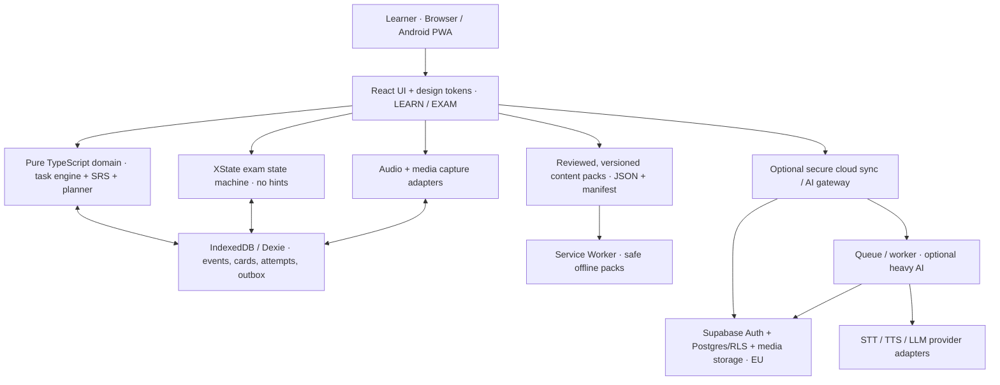

# ADR-022 — Hospodar YKI: оптимальний стек та модульна local-first архітектура

> **Інтеграційний план 22.10.2026 — [ADR-027](27-stack-architecture-compatibility-and-implementation-gates.md):** design-fit стеку/архітектури оцінено окремо від реального implementation readiness. Уточнено два типи подій (чернетка vs незалежна перша відповідь), native bridge та обов'язкові Web/Android/PAD release gates. Для критичних Android-даних чинний ADR-024 (Kotlin Room), а не IndexedDB. **React/Phaser/Capacitor/PAD ще не пройшли end-to-end інтеграцію.**

> **PRODUCT AMENDMENT — ADR-023 (21.10.2026):** Додаток має бути також **2D Android-грою з повністю встановленими офлайн-мультимедіа ~2–3 ГБ**. Канонічна додаткова специфікація: [23 — Android offline game/Google Play Asset Delivery](23-android-offline-game-and-3gb-media-architecture.md). Вибір нижче **доповнено** Phaser для ігрових сцен, Capacitor 8 + Kotlin для Android і `install-time` Play Asset Delivery для ліцензованого медіа. Дві оболонки **Web/PWA та Android**, один TypeScript домен. Попереднє оцінювання **95/100 зроблене до вимоги Android-гри** і не є виміряною оцінкою APK/PAD/game performance. Самостійний один `.apk` 3GB не обіцяємо. До підтвердження на реальному Android/Google Play це лише архітектура.


> **Дата:** 21.10.2026 · **Статус:** ACCEPTED AS TARGET ARCHITECTURE — дизайн-рішення, **не реалізація міграції**.  
> **Ціль:** повноцінне B1/B1+ навчання фінської, 4 навички, натуральне аудіо/розмови, вимірюваний SRS, AI feedback, **навчальний режим та максимально достовірна репетиція цифрового YKI 2027**, мобільна UX і low-cost deployment.  
> **Основа:** [11 — MVP ТЗ](11-mvp-product-requirements.md), [15 — 2×4 режимів](15-two-modes-skill-scopes.md), [19 — наука навчання](../research/pedagogy/19-learning-books-to-engineering-2026-10.md), [20 — офіційний YKI](../research/yki/20-yki-official-complete-audit-2026-10.md), [21 — fidelity/державний іспит](21-digital-yki-exam-simulator-executable-spec.md).  
> **Структурований ADR:** [research/architecture/architecture-decision-v1.json](../research/architecture/architecture-decision-v1.json).  
> **Публічні технічні джерела:** наприкінці документа.

## 0. Остаточне рішення

**Модульний моноліт, TypeScript-first, offline/local-first PWA, static-first hosting, cloud as optional services.**

| Шар | Вибір | Коли і чому |
|---|---|---|
| UI | **React 19 + TypeScript strict + Vite 8**, React Router, CSS tokens + Tailwind CSS, невелика бібліотека доступних headless-компонентів Radix/shadcn | Компоненти для режимів/задач/доступності, проста статична збірка, не потрібен SSR в навчальних завданнях |
| Навчальний домен | Чисті **TypeScript functions**, малі use cases, Zod-validated content contracts | Легко тестувати planner/SRS/error ledger окремо від фреймворка |
| Симулятор | **XState v5** тільки для складних workflow (exam/voice/recording), чиста доменна scoring-policy | Строгі переходи, жодного витоку підказок, відновлення перерваного іспиту |
| Client storage | **IndexedDB + Dexie**, версійні міграції, append-only attempt events, короткий lightweight preference store | Багато відповідей, outbox, локальні записи аудіо, offline without account; `localStorage` тільки для нецінних дрібних налаштувань |
| Offline/content | Service Worker + **Workbox/vite-plugin-pwa**, manifest і версійні installable offline-пакети | Контроль розміру кешу; зміна bundle не руйнує поточний іспит |
| Доставка фронтенду | **Static CDN (Cloudflare Pages або еквівалентний static hosting)** | Мінімальна вартість для SPA, preview deployments; без необхідності постійного Node сервера |
| Cloud opt-in | **Supabase PostgreSQL + Auth + Storage + RLS, EU exact region** | Лише коли потрібні облікові записи, sync, cloud media, оцінювання; не блокувати offline/no-account |
| API/server | Легка **TypeScript boundary** з provider adapters; на першому етапі managed Edge Functions для коротких AI calls і authorized actions | Secrets ніколи не в browser; typed I/O, rate limit, consent, feature gates; не прив'язувати домен до SDK |
| Heavy AI/audio work | **Окремий асинхронний worker + queue (P1/P2)** для STT/TTS/LLM й медіа, за необхідності контейнерний Node у EU | Long-running recording/transcription не має залежати від HTTP timeout чи UI; Edge Functions мають CPU, wall clock limits |
| Content media | Git = metadata/rights/schema/script; **об'єктне сховище** для важких файлів із контрольними сумами, підписаними URL за потреби | Не наповнювати Git великими відео та дублями MP3; права та незалежне versioning |
| QA | **Vitest + Playwright + Axe/keyboard a11y + existing Node/Python validations + GitHub Actions** | Deterministic unit/property tests, mic/audio mocks, real browser incl WebKit/Android |
| Packages | **pnpm workspaces** без Nx/Turborepo на старті | Один репозиторій, спільні типи/пакети, без orchestration overengineering |
| Observability | privacy-safe structured diagnostics, **Sentry optional and consent-aware**, metrics aggregate | Насамперед відслідковуємо втрату відповідей, crash, media failures, незавершені сесії; не записуємо аудіо/текст відповідей у журнали |

**Версії:** lockfile пінить actual patch/minor versions після compatibility audit. `Vite 8` (офіційний реліз 12.03.2026); React 19.3 є актуальною стабільною гілкою станом на 21.10.2026. Не жорстко прив'язувати бізнес-домен до конкретного patch.

### Навіщо не Next.js як default?

Hospodar — **авторизований навчальний app shell із великою кількістю client-side state, локальним аудіо, таймерами й offline**; SEO/SSR корисні для окремих маркетингових сторінок, але не для основних вправ. Next.js full-stack додає server/render/cache та deployment topology без критичної необхідності. Marketing/docs можна окремо віддати SSG або pre-render, **не** перебудовуючи exam workflow на server components. React Router SPA підходить для статичного deploy.

**Не заборонено:** Next.js стане хорошим варіантом, якщо пізніше з'явиться істотна SEO-driven public content platform або щільно server-rendered classroom/admin продукт. Це майбутній новий ADR, не reason зараз платити complexity tax.

## 1. Розгляд тричі: 3 незалежні аудити

### Audit A — відповідність навчальній задачі / YKI

- **Рівно 2 головні політики**, не 2 незалежних застосунки: `LEARN` дозволяє feedback, self-fix, context transfer та SRS; `EXAM` забороняє підказки до submit і оцінює модулі окремо.
- **4 навички** `reading/listening/writing/speaking` з одним `Task` schema, але distinct skill-specific renderers/evaluators. `learning planner` не впливає на `exam blueprint selection` except frozen content manifest.
- **XState** для `exam`, `speaking turn`, `record capture`, `post-submit` дає fail-closed переходи. Не вводити XState для кожного кнопкового toggle, щоб не робити складність самоціллю.
- Pure `content engine` читає reviewed/licensed JSON/manifest і може працювати без internet; `teacher_review_status` та source rights обов'язкові.
- **AI не оцінює офіційний CEFR/YKI**: structured suggestion і confidence, можливість відмовитися від оцінки та людські якорі.

### Audit B — безвідмовність, медіа, офлайн і тестованість

- `localStorage` для великих аудіо/історій погано підходить, тому **IndexedDB**; Dexie спрощує міграцію схем і reactive queries.
- PWA offline: **shell + явно обрані packs**, але не кешувати всі великі відео/години аудіо; storage quota/eviction залежать від браузера, тому експорт/optional sync і visible offline availability.
- Аудіо WebM/Opus vs MP4/AAC у браузерах перевіряти через `MediaRecorder.isTypeSupported` і real-device smoke; `STT recognized` ≠ valid pronunciation.
- Exam attempt local event log + snapshot transaction, monotonic clock for elapsed timers and wall-clock anchor for restore, check clock drift. **Strict real timer fidelity blocked** до verified OPH profile.
- Іспит **не auto-update PWA серед активної сесії**. Показати запит оновлення після `submitted` або `aborted`, не `skipWaiting()` відразу.
- Local response data and recording blobs ніколи не змішувати з static manifest/cache; browser process kill, mic permission revoke, low-space, quota exceeded — окремі тестові випадки.
- No-copy and no-back UI **неможливо зробити криптографічно непорушними у browser offline**: справжні оцінні ключі в клієнтському bundle можна витягнути devtools. Для *serious held-out scored online assessment* ключі й оцінювання тримати на server; offline only honest practice.

### Audit C — підтримка, ризики, бюджет, scalability

- Одна мова у UI/domain/API (**TypeScript**), один repo, мінімум build/dev tools, без Kubernetes, GraphQL, Kafka, Redis, websocket у першому релізі.
- Serverless/static на початку, **managed Postgres/Supabase EU region** лише за потреби accounts/sync/AI. Не тримати сервер для локальних карток.
- Supabase database/auth storage з конкретним **EU AWS region** для персональних даних; **сама EU локація не доводить GDPR compliance**; треба DPA, transfer mapping, subprocessors, retention/deletion, consent.
- Для великого каталогу медіа storage vs distribution окремо; можна почати з Supabase Storage, за трафіку підключити R2 `jurisdiction=eu` **(не плутати `location_hint=weur` із гарантією юрисдикції)**; медіа адаптер приховує provider.
- Product content/source verification є більшою цінністю ніж ранні distributed services. Ops бюджет спрямувати на **S2 рецензування, живе аудіо, багатоголосі діалоги, об'єктивну оцінку покращення**.
- Escaping native HTML/URLs, CSP, account RLS, prompt injection boundaries, rate limiting and media permissions. Жодних service role keys у браузері.

### Порівняння варіантів (орієнтовні engineering scores)

| Стек | Maintainability /30 | Offline + exam reliability /25 | Interactivity + voice /20 | Deploy cost /15 | Portability /10 | Разом /100 |
|---|---:|---:|---:|---:|---:|---:|
| **React + Vite + TS + local-first + opt-in Supabase** | 29 | 24 | 19 | 14 | 9 | **95** |
| Next.js + React + cloud-first Supabase | 27 | 18 | 19 | 13 | 8 | **85** |
| SvelteKit + TS + local-first | 26 | 21 | 18 | 13 | 8 | **86** |
| Нинішній vanilla JS + `localStorage` | 19 | 15 | 13 | 15 | 8 | **70** |
| Microservices + Kubernetes + dedicated speech services відразу | 18 | 20 | 19 | 5 | 8 | **70** |

**Оцінки — експертне порівняння fit, НЕ measured runtime benchmarks, security audit чи гарантована якість.** Відмінність 1–3 бали сама по собі не статистично значуща. Надати перевагу React + Vite через безперервний migration path, поширеність, продуманий offline-first стан.

## 2. C4-ish контейнери / data flow



**Boundary direction:** `ui → application use-cases → domain ← infrastructure adapters`; **domain imports neither React nor Supabase**. Exam clock/state/score rules must run and be tested without browser or network. Presenter resolves UI-language `uk` vs exam-language `fi` from policy, never from per-component developer whims.

### Modules — target, not current paths

```text
repo/
├─ apps/
│  └─ web/                        # React + Vite PWA; /learn /exam /progress /content
├─ packages/
│  ├─ domain/                     # Task, attempt, learner, SRS, error taxonomy, goals
│  ├─ exam-engine/                # XState, profile gates, transitions, exam scoring
│  ├─ content-schema/             # Zod JSON schemas, provenance, audio manifests
│  ├─ learner-planner/            # 4 skills adaptive scheduling, unknown/known vocab
│  ├─ media/                      # playback, recorder, waveform, codecs, offline cache
│  ├─ ui/                         # visual system and accessible primitives
│  └─ contracts/                  # stable API/events, only when cloud enabled
├─ services/
│  └─ gateway/                    # later: Edge Functions/worker for consented AI
├─ content/                       # existing JSON primary source: gradual migration
├─ audio/, video/, brand/         # existing metadata/assets: do not destructively move
├─ scripts/                       # validators, importers, rights, S2 review
├─ docs/, research/
├─ pnpm-workspace.yaml
└─ .github/workflows/
```

**Do not introduce empty packages until first feature needs them.** Phase A can keep current `app/` as a parallel runnable baseline while `apps/web/` is scaffolded. When content loaders and all regression tests pass, route cutover; then deprecate, never abrupt delete. Preserve Git URLs/docs and public content links.

## 3. Shared content engine / schema

Recommended `ContentItem`:

```ts
type ContentItem = {
  id: string;
  version: string;               // immutable when publishing
  skill: "reading"|"listening"|"writing"|"speaking";
  family: string;                // from research/yki/yki-official-patterns-v2.json
  topicId: string;               // T01..T09
  functionIds: string[];         // F01..F06
  cefrHint: "A2"|"B1"|"B2"|null;  // hint != validated CEFR level
  instructionsFi: string;
  assetRefs: string[];           // content-addressed MP3/WAV/VTT, not raw blobs
  origin: "original"|"external_link_only"|"licensed";
  rights: {license: string; sourceUrl?: string; allowedUses: string[]};
  editorial: {status: "candidate"|"S2_reviewed"|"approved"; reviewerRef?: string};
  assessmentPolicy: "training_only"|"objective_key"|"human_review";
  cuePolicy: "learn_feedback_only"|"no_cue";
  contentHash: string;
};
```

**Never store secret answer keys in a public bundle and claim secure assessment.** `contentHash` and semver content snapshot prevents changing a task after a learner's answer. Importer checks JSON/Zod, `unique id`, references, timed VTT audio alignment, locale, normalized diacritics, rights, provenance, and independent source review. `candidate` content can be explored in editor; do not mark as official/reviewed in released scored practice.

### Task family renderers

One registry maps `family → Component + input validator + completion policy + evaluator`: `MCQ`, `TRUE_FALSE`, `SHORT_OPEN`, `CLOZE`, `GUIDED_WRITING`, `OPINION`, `SPEAKING_MONOLOGUE`, `SPEAKING_DIALOGUE`, `SITUATION_REPLY`. New type added by plugin-like **registry entry**, not fork of the application. Defaults `no official grading` for all productive responses.

## 4. Exam engine — strict isolation by design

```text
select_mode → choose_scope → system_check → instructions → ready
  → section_intro → item_prepare? → item_respond → item_commit
  → next_item | section_complete → next_section? | finish_confirm
  → submitted (immutable) → practice_report → optional_learning_review
```

- Freeze `exam_profile_id`, `profile_version`, `contentPackHash` at `ready`; **no PWA/package upgrade mid-attempt**.
- `practice_exam` vs `official_2027_verified` fully separated; **currently strict `official_2027_verified` disabled** owing to [15 undocumented digital fields](../research/yki/official-yki-deep-audit-v2.json). No paper sample timer accidentally becomes digital rule.
- Attempt store = **append-only events** `ATTEMPT_STARTED`, `ANSWER_DRAFT_SAVED`, `AUDIO_RECORDED`, `TASK_COMMITTED`, `SESSION_SUBMITTED`. Snapshots for fast resume.
- **First submitted answer immutable**; practice feedback only **after** `submitted`. User-visible `answer_draft` can be edited before commit only under session practice policy; exam-specific navigation not marked official without evidence.
- Redo prompts/independent retest cannot share `item_version` or `exposure_history` silently.
- If browser loses mic or audio file, `capture_error` / `not_assessable` not made into `completed=true` with implied grade.
- `objective` responses produce key accuracy; `writing/speaking` produce `submitted/ungraded/pending_human`. No aggregate `YKI grade` by arbitrary weighted formula.

### Timer, resume, and network isolation

Do not use only `setTimeout` as clock: timers throttle background tabs/mobile. Read elapsed duration using `performance.now()` while active, record wall-clock anchor and pause policy at checkpoints, compare drift on restore; mark suspect clock changes rather than claim official invigilated timing. Where official digital timer unknown, use explicit **training timer**. For local task response use IndexedDB transaction per meaningful update; on browser close without previous persisted save, cannot promise zero bytes lost. Restoration E2E test on `reload` and `kill tab` plus storage quota tests.

## 5. Learning engine — scientific methods wired into data

- `Diagnosis` produces four **distinct** mastery signals with uncertainty; never a fabricated `B1_score=80%`.
- `Planner` allocates time to **due recall + weakest skill + communicative goal + transfer**, with 10/20/30 minute adjustable sessions and non-starvation policy.
- `SRS` current `1/3/7/14/30` deterministic baseline is **valid interim heuristic**; transition to data-based **FSRS-like review for lexical/chunk retrieval only** after enough history. Do not force lexical card scheduler onto free speaking/writing/rubric outcomes.
- `Error log` distinguishes grammar cases (`illatiivi/elatiivi` etc.), word order, lexical rection, conversation strategy, fluency, comprehension. Flag error when evidenced, not hallucinated from AI.
- `Feedback`: communicative **meaning first**, targeted form correction after independent answer, repair, a **different** unseen context; cite source content or explicit teacher notes.
- `Audio`: natural licensed audio, many speakers and speed/accents, transcript withheld in exam, Finnish long-short quantity minimal pairs; no fake phonetic certainty from ASR transcription.
- `Learner vocab`: mark `unknown/confused` only after evidence or user selection; `lemma/chunk/sense/context/review schedule`, not import every word as «невідоме».
- `Holdout`: independent item pool for 7/14-day cueless transfer tests; showing canonical answers or transcripts invalidates unseen status for that item/version.
- `Experiment`: simple, opt-in privacy-preserving A/B protocol; outcome: independent retained skill, not streaks.

## 6. Storage: local events now, sync later

Proposed IndexedDB stores: `contentPacks`, `attemptEvents`, `snapshots`, `cards`, `skillEvidence`, `errors`, `assetIndex`, `localMedia`, `outbox`, `preferences`.

```ts
type AttemptEvent = {
  eventId: string;       // UUIDv7 or other globally unique identifier
  deviceId: string;      // client-scoped pseudonymous ID
  sessionId: string; attemptId: string;
  itemId: string; itemVersion: string;
  type: string;          // task_started, answer_submitted, hint_seen, feedback, ...
  payload: unknown;      // validated per type
  occurredAt: string;    // not trustable as true exam wall-time by itself
  revision: number;
  syncStatus: "local"|"pending"|"synced"|"rejected";
};
```

**Offline outbox sync (opt-in)**: event idempotency server unique `eventId`; retries never double-count SRS; immutable attempt events merge by ID; conflict state if same item/session revision diverges; **do not silently last-write-wins** two active exam attempts. User signs in after offline use → explicit consent to upload selected progress, raw voice separately opt-in. `guest` stays fully usable.

**Audio storage:** local `Blob` in IndexedDB optional, clear/delete when user requests, no automatic cloud. Long files subject to browser quota eviction; optional signed/expiring uploads with retention policy and user choice. Static/cache bundles contain only public, licensed audio.

## 7. Secure optional backend

```text
Browser (authenticated optional)
 → Edge/API Gateway [rate limits, auth, consent check, schema validation]
   ├─ short structured LLM/STT requests → provider adapters → low-risk feedback
   ├─ Postgres/RLS [accounts, events, synced progress, assessments]
   └─ job enqueue → durable worker [long audio / retries / transcription]
                       → scoped object storage and reports
```

- **Exact Supabase region** choose `eu-central-1` Frankfurt or `eu-north-1` Stockholm (not vague `Europe` if EU jurisdiction is mandatory). Docs caution general "Europe" group can include UK/Switzerland; GDPR is shared responsibility, data can traverse providers.
- `RLS` for every user-owned table/storage prefix, authenticated `auth.uid() = owner_id`, deny by default; enforce on server APIs too. Never expose `service_role` to browser.
- Optional email auth/magic link. Minimal data; privacy export+deletion; disclose AI processor, retention windows and possibility of out-of-EU processing; honor Finnish/EU rules as verified at deployment.
- `Queue` needed for robust heavy STT/TTS; Supabase Edge Functions published limits (CPU 2 sec/request, duration plan-dependent) make it unsafe as universal replacement for real worker. Use a small EU container worker when needed, not before.
- Media CDN: initially Supabase Storage is simplest, when size or distribution economics need use Cloudflare R2 **EU jurisdiction restrictions**, not just best-effort location hint. Avoid putting personal recordings on global public bucket; lifecycle policies.
- HTTP JSON APIs under `/v1`, request/response type contracts, `Idempotency-Key` per job; no server session dependency for local study.

## 8. Delivery strategy (no big-bang rewrite)

| Phase | Deliverable | Acceptance / exit |
|---|---|---|
| **0: guard current MVP** | Add baseline of 4-skill/current 9-item UI snapshots, tests, copyright/media validation, benchmark bundles | Current `app/` untouched, regression suite all green |
| **1: typed core + shell** | `pnpm`, `apps/web` React/Vite; migrate core pure JS → TS **behavior-parity**, unique routes with shared brand/skip links | Same cloze correctness/SRS and same exercises; no loss of `localStorage` progress on import |
| **2: robust local-first** | IndexedDB Dexie, data migration v1, versioned content manifest, backup/export, service-worker packs and PWA install | Browser reload, offline mission, storage error and Android/WebKit tests pass |
| **3: full mode engine** | `packages/exam-engine` XState; `LEARN` planner and separate `EXAM` mode, single/all four skills, audio/mic state | 13 task families with correct component fallback; no hints/exam leakage; official exact profile remains disabled |
| **4: data/content scale** | reviewed vocab/chunks/long audio/speakers, S2 human editorial gate; separate held-out pools; stats | Valid source/rights, 7-day independent retest, source-backed audio manifests |
| **5: online opt-in** | Supabase EU Postgres + Auth + consent-driven progress sync; optional AI gateway/workers | RLS tests, deletion/export, queue retry/idempotency, budget and data map |
| **6: OPH 2027 fidelity** | Recheck after digital pilot, add only verified durations/UX/mic/playback, 2-rater assessment calibration | Each dimension has source and E2E evidence; **not** “official” certification |

**No invented delivery dates or person-days.** Each phase independently runnable; do not block language practice on voice AI or accounts.

### Rollback & migration

- Legacy `app/` remains accessible behind `legacy` route until migration parity + user data import verified.
- LocalStorage migration is **one-time, reversible via JSON export**, retains `firstAnswer`, `firstCorrect`, SRS interval and error chronology; missing voice blob cannot be reconstructed.
- Stage public content by `contentVersion`, not hard overwrite user progress; old attempt refers to frozen item version.
- Production deploy uses preview → canary → release. Content changes have separate validation/publish gate. Service worker waits to activate after exam finish, rollback keyed to frozen asset manifest.

## 9. Testing pyramid & fitness functions

**CI blocking:**
1. `typecheck`, ESLint/Biome, bundle/size audit, dependency vulnerability scanning and lockfile.
2. Unit tests for item validation, Finnish normalization (`ä/ö`), SRS dates across DST Helsinki, planner fairness, duplicate events, exam mode hints forbidden.
3. Property-based tests for illegal exam transitions, scoring abstention when speech missing, unknown 2027 profile cannot be `strict`, all content references/rights.
4. Playwright Chromium/Firefox/WebKit plus **physical Android Chrome and iOS Safari media smoke**, permissions, task count, persistence, offline, audio, OS background, mid-exam app update.
5. E2E recovery: refresh, tab-kill, low storage/quota error, device clock shift; no silent `graded` outcome if answer/media lost.
6. Supabase RLS malicious-user tests before opening accounts; rate limiting, ownership on media links, webhook idempotency.
7. S2 review and independent unseen writing/speaking double-scoring calibration; not artificially simulated by LLM eval.
8. Accessibility: WCAG AA contrast, keyboard, screen reader, reduced motion, color not sole cue; Finnish semantic cues and Ukrainian text visually distinguishable.

**Engineering acceptance targets (hypotheses, not benchmarks):** 4-skill coverage; 0 key reveals before exam submit; 0 false grades in productive modules; zero known rights-violating media; recovery passes realistic test matrix; no console error on course mission; 100% events have contentVersion and eventId; PWA can run small explicitly downloaded offline pack. Measure p75 first-contentful UI and response latency on mid-range Android before assigning hard budgets.

## 10. Decisions explicitly rejected for current stage

- **No** Next.js SSR everywhere, Kubernetes, dedicated microservices, event broker, Redis, GraphQL or bespoke real-time sockets just to render flashcards.
- **No** storing GB of media in Git or versioning long binary files on every update; keep metadata in repo.
- **No** student raw voice upload without clear opt-in + provider retention policy.
- **No** direct LLM vendor key in browser, AI-based CEFR passing promise or automatic pronunciation correctness via STT alone.
- **No** paper-format 2011 timers mislabeled as OPH digitesti 2027.
- **No** deleting current working MVP before regression tests, source parity and migration/export.
- **No** attempt at “impenetrable offline exam” when code+keys are distributed locally.
- **No** infinite personalization with fixed so-called "visual/auditory learner types"; select modality by target skill and evidence.

## 11. Public technical sources, checked 2026-10-21

- [Vite 8 March 2026](https://vite.dev/blog/announcing-vite8), [Vite release support](https://vite.dev/releases), [React official blog](https://react.dev/blog).
- [React Router framework vs data mode](https://reactrouter.com/start/modes), [SPA deployment](https://reactrouter.com/how-to/spa).
- [XState v5 state machines/persistence](https://stately.ai/docs), [Dexie React IndexedDB](https://dexie.org/docs/Tutorial/React).
- [MDN offline/PWA cache](https://developer.mozilla.org/en-US/docs/Web/Progressive_web_apps/Guides/Caching), [storage quotas and eviction](https://developer.mozilla.org/en-US/docs/Web/API/Storage_API/Storage_quotas_and_eviction_criteria).
- [Playwright browser matrix](https://playwright.dev/docs/browsers), [vite-plugin-pwa](https://github.com/vite-pwa/vite-plugin-pwa).
- [Supabase project regions](https://supabase.com/docs/guides/platform/regions), [data residency/transfer FAQ 06.10.2026](https://supabase.com/legal/privacy-resources/data-residency-and-transfers-faq), [Postgres RLS](https://supabase.com/docs/guides/database/postgres/row-level-security), [Edge Functions limits](https://supabase.com/docs/guides/functions/limits).
- [Cloudflare R2 EU jurisdiction vs location hints](https://developers.cloudflare.com/r2/reference/data-location/).

## Final verdict

**TARGET 95/100 engineering fit**, contingent on implementation/QA, not a claim of finished code. Adopt TS/React/Vite + Dexie + XState + local-first PWA **now in phases**, Supabase EU + AI worker **only when justified**. The strongest moat for Hospodar YKI will be **authentic licensed Finnish audio, reviewed high-value tasks, independent 7/14-day retention outcomes and reliable four-skill exam workflow**—not the maximum number of technologies.

## ADR-023 Web/PWA parity — explicit equal-priority platform requirement

[23 — Dual-platform Android + full Web/PWA with 2–3GB offline media only on Android](23-android-offline-game-and-3gb-media-architecture.md). The original choice of React 19+Vite 8+Phaser in game scenes+TypeScript domain is now a **single shared codebase for Web and Android**. For Web: browser/desktop/mobile PWA, CDN/HTTP streaming of licensed content, opt-in selected offline packs, no 3GB first-load. For Android: Capacitor+native Kotlin player, all redistributable bundled media from install-time PAD packs. Same learn/exam workflow, 4 skills, progression, stories, item IDs and accessibility. Optional authenticated sync later. New acceptance `WEB-01…10`. Neither web parity nor native app is implemented by this ADR alone.

## ADR-024 — зміна для **максимальної надійності** (22.10.2026)

**[24 — Production-reliability hardened architecture](24-reliability-hardened-architecture-web-android.md)** уточнює це рішення: **Web IndexedDB/Dexie, Android Kotlin Room/SQLite для цінного learner/exam progress**, обидва за спільним TypeScript `LearnerRepository` контрактом. Таким чином старе узагальнення «Dexie/IndexedDB для Web і Android» **більше не є остаточною рекомендацією**. Звичайний UI React/Vite, Phaser 2D, Capacitor, XState, PAD/media adapters і optional EU backend лишаються незмінними. Мета — атомарне збереження `first_attempt + snapshot`, fail-closed `SAVE_FAILED` і надійне відновлення тривалого іспиту. Важливо: додатковий Android Room/Kotlin bridge **поки не реалізований**.
