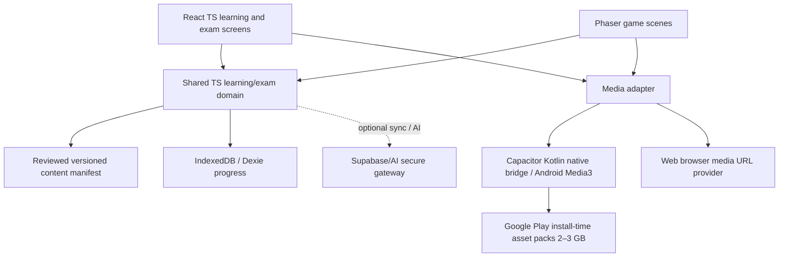

# ADR-023 — Hospodar YKI: Android game 2–3 GB з усією дозволеною мультимедіа офлайн

> **Стан рішення (22.10.2026):** цей ADR визначає game/distribution goals. Пізніший [ADR-024](24-reliability-hardened-architecture-web-android.md) **замінює ранній Android IndexedDB/Dexie вибір** на Room/SQLite для критичного прогресу; [ADR-027](27-stack-architecture-compatibility-and-implementation-gates.md) уточнює єдиний контракт, `packId` resolution та вимірювані інтеграційні gates. Документація — не підтвердження Android/Play релізу.

> **Дата:** 21.10.2026 · **Статус:** ACCEPTED PRODUCT CONSTRAINT + TARGET ARCHITECTURE, NOT IMPLEMENTED.  
> **Оновлює** [ADR-022](22-optimal-stack-and-architecture-adr-2026-10.md) — mobile game та large installable media pack стають P0, а веб/PWA лишається доступною з тим самим предметним рушієм.  
> **Джерело вимоги:** користувач хоче **Android-гру, приблизно 2–3 ГБ, із усім мультимедійним навчальним контентом у встановленні, без потреби скачувати уроки після запуску**.

## 1. Рішення після трьох перевірок

**TypeScript домен + React/Vite UI + Phaser 2D scenes + Capacitor Android shell + Kotlin/native media bridge + Google Play Asset Delivery install-time packs.** Сервер необов'язковий. Одна реалізація чотирьох навичок, того самого syllabus, діагностики/SRS та строгого YKI mock на web і Android; різні лише вхідний UI та нативний спосіб отримання/відтворення медіа.

- **Навчальний продукт:** 4 навички, Learn та Exam, review/SRS, лексику й grammar, genuine audio, транскрипти, відео, спілкування, тест 7/14-day без підказок, user progress локально.
- **Гра:** animated 2D world, NPC розмови фінською, діалогові розвилки, сюжетні/побутові квести, city/area map, мініігри для слухання, читання, фонетики і відмінків. **Не** додавати «гейміфікаційні» бали, які підміняють результат чи серію днів.
- **Симулятор YKI:** нейтральний examination UI **без game canvas, NPC або cue всередині тесту**; 4 modules, task versions, scoring separation, unconfirmed OPH digital UI marked practice.
- **Android-пакунок:** Google Play **AAB (developer upload artifact) + кілька Play Asset Delivery install-time packs**. У користувача **одна дія встановлення через Play**; це **не буквально один APK 3 GB**, і не інсталяція AAB вручну.

### Уточнення вимоги «один файл 2–3 ГБ»

Відрізняти два результати, які технічно не тотожні:

1. **Google Play route (рекомендовано):** install via Play one-tap; Android App Bundle розгортається в optimized device-specific APKs плюс *install-time* packs, встановлює весь запланований контент до першого старту; **офіційні межі на 21.10.2026:** base module до **500 MB**, один asset pack до **1.5 GB**, сумарно base + install-time pack до **4 GB** compressed download size. Це **дозволяє ~2–3 GB**. Для дистрибуції необхідні Gradle asset packs із delivery type `install-time`; AAB не слід плутати із самостійно встановлюваним .apk.
2. **Direct one-file offline installer outside Play (експеримент, НЕ гарантований):** бажання мати **один .apk розміром 2–3 GB** є окремим R&D. Офіційні Google Play APK size limits для legacy APK — **100 MB**, і чинний Play distribution для нових застосунків через AAB; велетенський sideload APK не є перевіреною сумісною схемою. Без POC із підписом/zip/APK-tool limits, `adb install`, реальними Android 10–16, storage/OS integrity **не обіцяти** його працездатність. Якщо strict single-downloadable-file критичний поза Play, окремо оцінити підписаний offline installer archive + small signed app і механізм ручного content import; але це **вже не один APK, який Android встановить одним натиском**.

Sources: [current Google Play size limits](https://support.google.com/googleplay/android-developer/answer/9859372?hl=en), [Google Play Asset Delivery integration, Kotlin/Java](https://developer.android.com/guide/playcore/asset-delivery/integrate-java), [Android game size guidance](https://developer.android.com/games/optimize/game-size), [OBB legacy vs AAB](https://support.google.com/googleplay/android-developer/answer/2481797?hl=en).

## 2. Стек Android, web та гейміфікованого UI

| Шар | Вибір | Чому |
|---|---|---|
| Shared domain | **TypeScript strict**, isolated `packages/domain` + `content-schema` + `learning-engine` + `exam-engine` | Єдина перевірена логіка на всіх платформах, без двох незалежних планувальників |
| Structured learning UI | **React 19 + Vite 8**, controlled text/voice/editor, brand tokens | Завдання, читання, письмо, accessibility, adaptive flow |
| 2D gameplay | **Phaser** as on-demand **subsystem** in `packages/game`; profile version pinned after benchmarks | Реальні сцени, sprite/animation/input/tilemap, task callbacks; не малювати довгі листи або exam question input в canvas |
| Android runtime | **Capacitor 8 + Android native Kotlin custom plugin** (pin actual supported version when scaffolding) | Native media access, microphone, back button, app lifecycle, share & media controls; one existing TS source |
| Large offline media | **Google Play Asset Delivery install-time**; native `AssetPackProvider` & `MediaAssetBridge` | First install ~2–3GB with packs present before launch, without manually downloading media after launch |
| Audio/video | **HTMLAudio/Video on web**, Android **native Media3/ExoPlayer or verified byte-range local provider** via bridge | Stream without loading 2GB in WebView memory; video seek/speech playback, lifecycle control |
| User state | **Web:** IndexedDB/Dexie; **Android:** native Kotlin Room/SQLite via one Capacitor command per atomic commit; app-private file storage only for consented user voice | Keep immutable attempt evidence and drafts distinct; **never** copy shipped 2–3GB media into DB or WebView cache |
| CDN/Internet | Optional for updates, cloud sync, live AI; all **pre-licensed bundled learning content** playable with airplane mode | Offline baseline is guaranteed only after full successful installation |
| Tests | Vitest + Playwright + Android instrumentation/Espresso + Google Play internal testing + physical low/mid devices | Real WebView audio buffer/seek, large pack delivery, progress persistence, GPU heat, lifecycle |
| Backend | Optional Supabase EU cloud sync, server-side AI transcription; optional local on-device STT as P2 separate model pack | No internet dependence for the **core game / curriculum / native playback**; online AI clearly marked optional |

**Godot alternative:** if product becomes a predominantly **3D free-roaming action game**, replace Phaser/Capacitor presentation with Godot and a separate content/domain bridge. That is a **new major architectural direction** (duplicated UI or portability layer, learning core shared only through portable schemas/API). Current product is 2D story-driven edutainment plus demanding DOM text workflows, so full Godot/Unity runtime adds cost without present benefit. [Phaser description](https://docs.phaser.io/) · [Capacitor Android](https://capacitorjs.com/docs) · [Godot Android export](https://docs.godotengine.org/en/stable/tutorials/export/exporting_for_android.html).

## 3. Native Android asset flow — crucial to making 3GB work

```text
AAB uploaded to Google Play
  ├─ base: Capacitor / React web bundle / small starter media / native plugins
  ├─ audio_fi: voice, long listening, speaking dialogue, prompts, subtitles
  ├─ video_fi: optimized offline video lessons / scene clips
  └─ game_world: sprites / atlases / NPC art / backgrounds / animations

Google Play delivers all install-time packs before first app start
 Android native Kotlin AssetPackProvider.resolve(assetId, version)
        │
       rights + SHA-256 + local pack readiness / paths
        ├── Media3/ExoPlayer local native playback, JS commands / progress
        └── (only if tested) WebViewAssetLoader mapped local URL
        │
Shared Typescript ContentResolver / MediaAdapter
        │
       React task player  ↔ Phaser world scenes
        │
       Web Dexie / Android Room learner events, NOT bundled media data
```

- Android PAD via `com.android.asset-pack` modules registered in Gradle; `install-time` packs arrive with install; `fast-follow` and `on-demand` **do not satisfy** «everything on first run without downloads». Pack asset-location strategy depends on type: install-time APK assets vs file-backed pack; **not** one generic filesystem path.
- Android `AssetManager` access for install-time bundles, local provider path for file-backed assets; **do not assume** `file://` files from PAD automatically work in a WebView or as seekable video. Build a **native adapter**. APK assets might be compressed and not seekable by file descriptor; streaming/byte-range/scheme compatibility is a required POC.
- Audio/video must have `mediaId, SHA256, rights, packId, relativePath, codec, container, durationMs, poster(optional), captions(optional), language, speakers, reviewStatus`. At runtime verify pack/version availability, not only manifest.
- **Lazy load** only the media for visible scene; release decoded audio/video and textures when leaving screen. Download size is **not RAM budget**. Do not attempt to pre-decompress entire 2–3GB to memory/storage.
- `localBundleMediaProvider` Android and `httpMediaProvider` web implement same interface. Native `play/pause/seek/timeupdate/ended/error` events mapped into TS. Text-only, reading-only and exam must work if GPU is unavailable.
- No autoplay of all media on app start. Video fallback captions, speed controls in learn only; exam audio replays/seek obey evidence-backed practice profile (2027 still unknown).
- Workbox/service worker for PWA web only where compatible. Android Capacitor uses installed packs and **must not rely on SW as source of truth**; verify Capacitor service-worker compatibility before enabling plugin injection.

## 4. Size budget (PROPOSED / NOT measured)

**Target:** one Play install, offline pack budget around **2.5 GB compressed download**, ceiling **3.0 GB** (not actual measured APK/AAB size). The following allocation is a planning envelope, **not inventory totals of existing repo**:

| Component | Planning budget | Installation |
|---|---:|---|
| Base Capacitor/React/Phaser/game shell, fonts, intro audio | ~140 MB | base |
| Audio `audio_fi`: licensed conversations, listening, slow/normal, short clips | ~850 MB | install-time pack |
| Video `video_fi`: lesson clips (e.g., modern language situations) | ~1,180 MB | install-time pack |
| Visuals `game_world`: scenes/sprites/characters/animations | ~320 MB | install-time pack |
| Reading texts, JSON banks, transcripts/subtitles, index + overhead reserve | ~110 MB | base or install-time |

**Total planning envelope ≈2.6 GB.** AAB Play per-pack compressed limit **1.5GB**, so isolate at least audio/video/game art as different packs. Base overall under **500MB**. Actual `bundletool get-size total`, Play Console installed/download sizes per device, max variant and per-pack size gate on CI; MIME/codecs compress differently. Do not fill content purely to hit 3GB: educational usefulness, human S2 review and license > size. A library with 2GB of poorly aligned filler is inferior to 800MB of great Finnish dialogs.

Disk-space warning: compressed download size != installed footprint, unpacked videos/codecs/cache and temporary install files can require **several extra GB**. Before download show Play/system size; Android own app offers a footprint meter, deletion/export, and user control. **Avoid hard-coded 'needs exactly 3 GB free' claims.**

### Video & audio encoding

- **Audio:** use supported efficient codec on Android (typically Opus in WebM/OGG, fall back AAC where needed), per-item speech intelligibility validated; stereo only when necessary, bitrate tuned per task—not one universal preset. Long pauses and redundant duplicates removed; source retains original high quality in restricted production storage, not all Git.
- **Video:** H.264/AAC MP4 compatibility baseline, optionally WebM/VP9 on tested devices; resolution and codec selected using **readability of captions + actual visual task**, not marketing 4K. Add `ffprobe` QA for codecs, duration, size and loudness. Keep subtitles separate `VTT` or internal tracks, disable exam transcripts before final submit.
- **Images/sprites:** WebP/AVIF if tested; texture atlas limits and low-memory profiles, images never decode together.
- **Rights:** many existing YouTube links, copyrighted lessons and SOLKI sample MP3 **cannot be bundled for offline redistribution by default**. The literal target is **ALL OWNED/RIGHTS-CLEARED MEDIA**. YouTube only accessible online by licensed official player, never quietly ripped into packs. Training tasks requiring outside resources must be replaced with reviewed offline originals.

## 5. Story design with scientifically useful loops

A proposed original world: **«Фінське місто»** with distinct quest locations (home, street, market, work, bus, library, clinic), a small friendly NPC cast, a visible goal and choice of next mission:

```text
2D town map -> NPC encounter -> problem framed in Finnish
  -> comprehension/choice or speaking/writing answer independently
  -> feedback on communicative success, one relevant hint after attempt
  -> self-repair -> NPC reacts -> new context -> SRS follow-up
```

Avoid energy/stamina payments, punitive streaks, jump-scares as a memory technique, bright looping confetti, hints that reveal the target prematurely, exclusive random rewards. Game achievements require **real communicative transfer**, not tap farming. `Skip scene`, `low motion`, `no audio` and `accessible text route` are **required** for learn.

**Exam mode:** no quest, rewards, animated character, stories or hints during attempt. Native Android system bars/notifications, sound interruptions, permission prompts, frozen content versions tested separately; no claim app can impersonate an actual proctored YKI.

## 6. Android-first C4 overview / modules



```text
apps/web/             React/Vite PWA — shared learn/exam views
apps/android/         Capacitor Android native project + Kotlin media/asset plugins
packages/domain/      CEFR-independent goal/scoring/attempt/events + learning SRS
packages/exam-engine/ fail-closed state machine, held-out exam content policies
packages/game/        Phaser scenes, quests, NPC triggers, animation, input
packages/media/       typed media loading, play/pause/seek and native/web adapters
packages/content/     manifest schema, rights, asset hashes and format validation
content/              original published learning materials (as today)
media-manifests/      published artifact manifest JSON + pack grouping (NOT 3GB git assets)
dist/android-packs/   generated by media build pipeline, ignored by Git
```

**Source and artifact policy:** metadata/ownership/rights in Git, large binaries published to versioned build artifacts/object store; auto-generate install-time Gradle asset packs in CI using authorized source assets. Release pipeline must be reproducible; raw copyrighted media is not pushed into public repository.

## 7. Acceptance criteria ANDR-01…18

- **ANDR-01:** Android app can open learn, 4 independent skill tasks, and exam mode with **airplane mode** immediately after first full Play install.
- **ANDR-02:** FULL pre-licensed media collection for release version included in **install-time** packs (none essential marked `fast-follow/on-demand`).
- **ANDR-03:** base bundle compressed ≤500 MB, each PAD pack ≤1.5 GB, base + install-time packs ≤4 GB, target total 2–3GB per measured reference device; failing threshold blocks release.
- **ANDR-04:** `Android bundle vs single external APK` formats distinguished accurately in UX/release notes, no promise of standalone 3GB APK until proven in compatibility spike.
- **ANDR-05:** offline playable audio/video seek/end/replay, correct MIME/codec, no duplicate 2GB copy in IndexedDB/cache, stable low-memory behavior.
- **ANDR-06:** no content downloaded at runtime for mandatory lessons after full install, including update checks, save state, 4-skill exam tasks.
- **ANDR-07:** manifest SHA256, packId, rights, contentVersion match installed payload; missing/corrupt data safely surfaced (no false lesson completion).
- **ANDR-08:** word/voice input, `ä/ö`, native Android Back, media interruptions, headphone disconnect, microphone permission/revoke, app resume.
- **ANDR-09:** guest profile stores attempts/voice locally by explicit policy; no raw speech uploaded automatically, GDPR and privacy.
- **ANDR-10:** exercises/tracks and game NPC/dialogue use same IDs and content; no duplicate topic/SRS logic between Android and Web.
- **ANDR-11:** `strict digital 2027` remains disabled until OPH-confirmed timing/controls; exam never shows gameplay/hints, correct answer before submit, subtitles unless evidenced.
- **ANDR-12:** gameplay skip/calm/reduced-motion/accessibility and 2D thermal/FPS checks on mid-range Android.
- **ANDR-13:** 7/14-day unseen progress and SRS do not depend on streaks/XP and remain offline.
- **ANDR-14:** Android OS upgrades, app version/asset-pack mismatch, low-space and reinstall recovery tested; no silent overwrite of learner history.
- **ANDR-15:** content publication gate rejects all unlicensed YouTube video downloads and SOLKI copyrighted MP3, unsupported external provider rights.
- **ANDR-16:** CI packages APK/AAB, runs unit/content rights validator, PAD size gate, installs with Play internal test; signs only in protected release pipeline.
- **ANDR-17:** if choosing direct-sideload single APK, explicit `adb install` compatibility matrix for 2GB/3GB with install/sign/versioning/format support before promise.
- **ANDR-18:** media engine has native playing/seek/paused/ended/error parity plus web fallback; no WebView console errors or blocked `file://` assumptions.

## 8. Build order: practical 5 gates, not 3GB before function

1. **Keep old MVP green**; finish ADR-022 React/TS extraction and 2-mode learning/exam contracts.
2. **Android playable vertical slice**: Capacitor + Phaser scene + one quest and one Finnish dialogue, airplane mode, `ä/ö`, mic consent; benchmark WebView FPS/memory. Validate integration **before** committing to Phaser as runtime.
3. **PACKING PROTOTYPE**: create synthetic (not copyrighted) install-time audio/video test packs, including **>1 GB**, build release AAB, Play internal test, verify seek/loop/first offline launch, measured size and storage.
4. **Actual media library**: collect owned/licensed source WAV/MP4 etc, human S2 review/transcripts, transcoding pipeline, pack manifest; pack actual content 2–3 GB if educational value justifies volume.
5. **Release + QA**: Android native physical device test matrix, user consent/privacy/content validation, no exact YKI grade; signed Play AAB plus optional distribution strategy for non-Play.

**No claim the app is currently an Android release, a finished game, or a 3GB downloadable file.** All above is a design/specification; coding and packaging come after accepted architecture.

### Primary official resources

- [Google Play app download caps](https://support.google.com/googleplay/android-developer/answer/9859372?hl=en)
- [Native/Kotlin Play Asset Delivery](https://developer.android.com/guide/playcore/asset-delivery/integrate-java)
- [Android game download optimization](https://developer.android.com/games/optimize/game-size)
- [Android App Bundles / APK expansion legacy](https://support.google.com/googleplay/android-developer/answer/2481797?hl=en)
- [Capacitor (Android native shell/plugins)](https://capacitorjs.com/docs)
- [Phaser official rendering capabilities](https://docs.phaser.io/)
- [WebViewAssetLoader PathHandler](https://developer.android.com/reference/androidx/webkit/WebViewAssetLoader.PathHandler)
- [Android storage quotas](https://developer.android.com/guide/topics/data/data-storage)

## 9. Повний ВЕБЗАСТОСУНОК — та сама гра, а не скорочена demo-версія (WEB-01…10)

**Обов'язкова продуктова вимога:** Hospodar YKI є **одночасно Web/PWA та Android game**. Вебверсія **не вторинна** і не потребує встановлення Android. В одній TypeScript кодовій базі працюють однакові чотири навички, звичайне навчання, full/single YKI practice, NPC, квести, картки/SRS та адаптивні тести. Платформні адаптери міняють **спосіб отримання медіа і системні API**, а не методику, контент чи формули прогресу.

| Потреба | Web/PWA | Android |
|---|---|---|
| Оболонка | React/Vite на desktop/mobile; installable PWA | Та сама збірка UI в Capacitor WebView + Kotlin |
| Ігровий світ | Той самий Phaser 2D, lazy-mounted | Той самий Phaser; Android FPS/thermal QA |
| 4 навички, SRS, іспит | Той самий TypeScript domain/exam engine | Той самий код, **без окремого Android-only SRS** |
| Аудіо/відео | HTTPS stream з lazy buffering; субтитри та seek; вибрані offline packs | Native seekable playback через пакети `install-time` |
| Встановлення | Відкрити URL; **не** змушувати завантажувати 2–3 ГБ | Одне Play встановлення з 2–3 ГБ approved media |
| Офлайн | App shell + явно збережені курси; не скачані файли недоступні | Весь rights-cleared release pack після інсталяції |
| Голос | Web MediaRecorder + permissions/codec fallback | Capacitor/Kotlin native adapter + permissions |
| Прогрес | Dexie/IndexedDB, export; optional consented sync | Такий самий формат events/versioning, optional consented sync |
| Update | SW activation **після** exam session; quota/eviction checks | Версіоновані app/asset pack оновлення, frozen exam manifest |

**Web file and content identity:** `Task.id`, `Task.version`, `mediaId`, transcript/subtitle/hash однакові; технічні bitrate/codec/URL можуть відрізнятися, але значення/складність й оцінювання завдання — однакові. Для Web реалізувати `WebMediaProvider`, а для Android `AndroidInstalledMediaProvider`; `useTask()` і `ExamEngine` залежать лише від інтерфейсу `MediaProvider`, не від `capacitor` або `window`.

**Web без зайвої фрикції:** користувач відкриває HTTPS URL і відразу може тренуватися. Тільки за бажанням встановлює PWA або завантажує конкретні audio/video packs. Показувати їхній реальний розмір, доступне локальне місце, статус завантаження і можливість звільнити кеш. Browser storage може бути очищений автоматично системою; export+optional consented sync, не обіцяти абсолютну незнищуваність даних.

### Acceptance для WEB/PWA (WEB-01…10)

- **WEB-01:** усі 4 навички, обидва режими Learn/Exam та повний/окремий модуль доступні через URL без Android.
- **WEB-02:** однакова індивідуальна task/content/version ID і shared learning/SRS/exam policy з Android; жодного форку навчальних алгоритмів.
- **WEB-03:** Phaser-гра з тими самими NPC/квестами працює і в браузері; keyboard, touch, reduced-motion та «без ігрових сцен» альтернативи.
- **WEB-04:** потокові права-очищені аудіо/відео, субтитри, seek, variable playback rate там, де це дозволено навчальним режимом; не вимагати 2–3 ГБ першого завантаження.
- **WEB-05:** web offline mode працює після явного збереження вибраних матеріалів, із чітким статусом `downloaded` / `online_only`; не рекламувати offline для недоступних файлів.
- **WEB-06:** PWA install, service worker asset versioning і update guard — не перезавантажувати активний екзамен; при зміні content pack підтримувати зв'язок зі старим completed attempt.
- **WEB-07:** прогрес, SRS, error log локально в IndexedDB, JSON export/delete і migration із нинішнього `localStorage`.
- **WEB-08:** mobile/desktop browser microphone consent, no silent-success recording; tested Android Chrome, Firefox, Chromium, WebKit й реальний iOS Safari.
- **WEB-09:** опційна синхронізація Web↔Android тільки після явного входу/згоди; ідемпотентні attempts, жодного automatic raw voice upload.
- **WEB-10:** інтеграційні parity-тести однакових task IDs, rubric policies, result statuses, subtitles, audio fallback на web та Android; fail-closed при різних content hashes.

**Ні Android, ні Web не вимагають backend** для базових власних уроків/іспиту/ігор (після отримання Web медіа), але cloud AI/STT може бути online-only і чітко позначається. Одна технологічна мова для domain та UI, platform-specific Kotlin тільки в тонкому native мосту.

**Статус:** повний Web/PWA parity — **специфікація, не готова реалізація**. Сьогодні web-MVP у `app/` працює; React/PWA та Android/Phaser не побудовано.

## 10. Посилення надійності Android та Web (ADR-024, 22.10.2026)

**[24 — platform-specific persistence + Android Media3/PAD + exam recovery](24-reliability-hardened-architecture-web-android.md)** має пріоритет для сховища відповідей. **Android:** Kotlin Room/SQLite замість WebView IndexedDB для критичних іспитових і навчальних записів, через типізований Capacitor bridge; **Web:** IndexedDB/Dexie з export/delete/optional sync. Медіафайли з `install-time` PAD не копіюються у базу. Нативний доступ до `install-time` ресурсів — `AssetManager`, перевірити seek/codecs з Media3 у Play internal testing. Google Play прямо попереджає про потребу **мінімум подвійного вільного місця відносно install-time pack size** для встановлення/оновлення; бажані 2–3GB не означають стільки ж вільного місця. `REL-01..REL-16` окремо тестують відновлення після kill, write failures, airplane-mode і оновлення даних. Не плутати архітектуру із виконаною міграцією.

## R05 follow-up 28.10.2026 — storage ceiling increased, implementation unchanged

**New product input:** Android full-offline install may use approximately **3–4GB**, rather than the earlier **2–3GB planned amount**. This amends the budget/ceiling, **not** the original target requirement that selected rights-cleared learning media arrive with the app before the first start. Never overwrite the existing ADR-024 Room/SQLite authority or claim currently built Android AAB/asset packs. Source: [Google Play size limits (checked 28.10.2026)](https://support.google.com/googleplay/android-developer/answer/9859372?hl=en) — base max 500MB, each asset pack max 1.5GB, cumulative base+install-time modules/packs 4GB **compressed as calculated by Play Console**. These ceilings may change and require re-verification at release; actual installed bytes, AAB zip size and pack extraction are distinct metrics. [Provisional allocation = 3,600MB and 400MB safety headroom](../research/pedagogy/32-r05-multitalker-phonetic-transfer-2026-10.md#5-34-gb-offline-installation-budget-product-design-not-file-size-measurement). One-tap install-time PAD, no mandatory after-launch downloads. No automatic assumption that Web/PWA can cache 4GB.

**Architecture unchanged:** accepted ADR-023 + ADR-024 + ADR-027, no new mobile stack. P0 licenses/meaningful multi-talker S2 content > filling capacity with decorative media. No 3–4GB media currently packaged. [Content rights intake](../sources/audio/R05-MULTITALKER-MATERIAL-INTAKE-2026-10.md), [sound/UX gates](../research/design/19-r05-sound-visual-design-transfer-2026-10.md). Pre-release real Play Console verification/low-storage/offline tests required.
