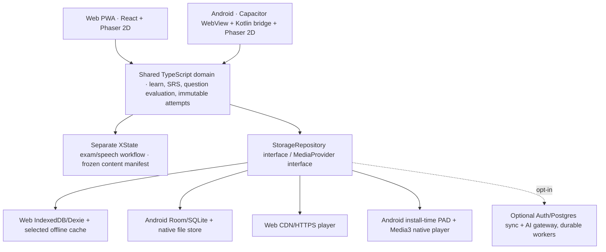

# ADR-024 — Hospodar YKI: production-reliability architecture (Web + Android + 2–3GB offline game)

**Date:** 22.10.2026 · **Decision:** recommended target, **NOT implemented**, no claim of measured 98/100 reliability.  
**Amends:** [ADR-022](22-optimal-stack-and-architecture-adr-2026-10.md) (TS/React/Vite, local-first), [ADR-023](23-android-offline-game-and-3gb-media-architecture.md) (Phaser 2D + Capacitor Android + Play Asset Delivery/Web parity); [YKI fidelity](21-digital-yki-exam-simulator-executable-spec.md).  
**Primary architectural difference versus ADR-023:** **separate persistent stores by platform** behind the *same domain-facing TypeScript Repository contract*. Browser: IndexedDB/Dexie. Android: **Kotlin Room/SQLite**. Do not claim IndexedDB is an equally durable source for exam/record data on both platforms merely because it works in the WebView.

## 1. Final product boundaries — one app, two delivery targets

- **Shared product:** monorepo, strict TS pure domain, all skills (reading/listening/writing/speaking), `LEARN` and `EXAM`, gamified missions, versioned content/item bank, SRS, goal completion, proficiency feedback clearly unofficial.
- **Web:** React/Vite HTML learning/exam UI, Phaser only when opening optional 2D scene; normal HTTPS streaming for media, explicitly selected Web offline cache; offline content depends on what the user downloaded.
- **Android:** Capacitor + Kotlin bridge, same React/Phaser UI, native Android media and persistence; **all legally distributable release media** included in **install-time** Google Play Asset Delivery (PAD) packs, available without post-install download. Standard app can play without network/cloud account.
- **AI/cloud optional:** async consented writing/speaking feedback, server-verified objective results for true confidential exam practice, optional account+cross-device event synchronization. The **core learning, preinstalled media and mock** must run with airplane mode.
- **No claim** this independently developed emulator uses 2027 exam software or awards real YKI scores. See 15 unknown OPH digital parameters.

### Trusted boundaries / C4



**Design rule:** `domain` imports **no React, Phaser, Capacitor, Supabase or database driver**. Platform-specific logic implements interfaces. `ExamEngine` and `LearningEngine` may share content IDs and task renderers but must **never share hint timing, scoring policy or answer visibility policies**.

## 2. Storage: two providers, one event schema (key correction)

### Core interface (TypeScript conceptual contract)

```ts
interface LearnerRepository {
  transact<T>(work: (tx: LearnerTransaction) => Promise<T>): Promise<T>;
  readSession(sessionId: string): Promise<SessionSnapshot | null>;
  listDueCards(day: string): Promise<Card[]>;
  exportEncryptedOrPortableBackup(): Promise<Blob>;
  deleteLocalLearnerData(): Promise<void>;
}
interface LearnerTransaction {
  appendOnce(event: AttemptEvent): Promise<"inserted"|"already_exists">;
  updateSnapshot(snapshot: SessionSnapshot): Promise<void>;
  upsertCard(card: Card): Promise<void>;
  queueSync(eventId: string): Promise<void>; // only if sync opted in
}
```

**Web driver: IndexedDB/Dexie**, versioned migrations, persist request `navigator.storage.persist()` where available; warns about quota and eviction and offers export+optional sync. Do **not** promise never-lost Web data. (MDN confirms browser default `best-effort` eviction.)

**Android driver: Kotlin Room/SQLite**, exposed by thin Capacitor Kotlin plugin. Use typed Kotlin entities/migrations, transaction for `appendOnce + snapshot + derived progress`; WAL where appropriate, no UI-thread DB work. Native app-private storage for consented learner-generated recordings, never the 2–3GB installed read-only course library; avoid duplicating blobs in both Room and WebView IndexedDB. Android DataStore for small preferences **only**.

**Reason this is worth the extra adapter cost:** the most valuable data are written answers, first attempts, spaced-review history and exam progression, not replaceable audio packs. Room is an Android-backed structured-data storage abstraction; it can survive WebView cache management better, though it cannot protect data against OS/user removal of app data, phone loss or broken disk. Provide optional sync or manual backup/export. Freeze `itemId + itemVersion + contentHash` in each event; do not score against a mutated future content pack.

**Event sourcing, but scoped:** append-only `AttemptEvent(eventId, learnerId?, deviceId, sessionId, itemId, itemVersion, payload, createdAt, order, profileVersion)`; events are definitive for first-answer truth, per-session snapshots speed up resume; no massive global event platform, Kafka or CQRS service. If disk write/transaction fails: show `SAVE_FAILED`, do **not** advance exam to next question. Never re-grade productive items if voice capture is missing. Commit responses before switching tasks. Avoid guarantee of surviving a crash that happened before persistence completes.

**Cross-device sync** is optional later: signed-in user gives consent, persist local writes first, durable outbox and idempotent server upsert by `eventId`, server stores same portable event envelope, explicit conflict resolution for simultaneous sessions. No default upload of raw voice or sensitive text in error logs.

## 3. Audio/video at 2–3 GB: installation ≠ memory ≠ browser cache

- **Google Play:** publish AAB; base module <=**500 MB**, each install-time pack <=**1.5 GB**, base+all install-time <=**4 GB** **compressed download** under current Play rules. User sees **one Play installation**, not one standalone 3GB APK.
- **Important disk-space caveat:** Android PAD docs warn install/update may require **at least twice the size of the install-time asset packs** in available disk space. A ~2.6GB release is a significant installation friction even if code is efficient. **Monitor uninstall/install failures** and consider a future lightweight separately offered edition only if product strategy allows it.
- Prefer 3–4 logically grouped `install-time` packs (audio, video, 2D world, perhaps reading media) with immutable `mediaId`, `contentHash`, `codec`, `duration`, `rights`, `assetPack`. **No** URL-only YouTube and SOLKI recordings bundled without redistribution rights.
- **Install-time PAD is split APK assets** and normally accessed with `AssetManager`; `fast-follow/on-demand` assets use different file-oriented retrieval. Do not assume all PAD packs are a single accessible filesystem folder. Check pack validity after every update/start; never cache absolute pack paths across versions.
- **Android player:** use Media3/ExoPlayer only when the tested `AssetDataSource` / descriptor works for actual codecs/containers, including byte-range seek and Android app lifecycle; an alternative verified local content provider can bridge playback. Avoid copying GB into app-private files or WebView cache at startup. Use lazy media loading.
- **Web:** HTTPS stream + caption files, optional selected downloaded packs via CacheStorage/OPFS where supported; browser quotas/eviction are nonuniform, UI must show `downloaded`, storage usage and `download_failed`. No forced ~3GB cold-start for Web users.
- **Memory:** file/package size does not dictate runtime RAM; decode only visible tracks/scenes, release Phaser texture atlases and player resources when hiding game/player, pause scene updates in background. Low-end Android adaptive quality; don't run a 60Hz game canvas while reading/writing text.
- **Codec QA:** Android primary MP4 H.264+AAC or separately tested alternatives; native audio format chosen for intelligibility with actual Finnish speaker, caption timing and device checks. Real source/voices rights, source hashes and media-transcode reproducibility.
- **Release safety:** manifest/media pack `version` frozen for active attempt; do not change exam content in-place. On update, record a resume-safe compatible pack or block/restart old attempt explicitly, not silently score with new questions.

## 4. Gameplay/learning vs official-style exam — absolute isolation

- Phaser renders **2D world/NPC/quest/map/animations**, not writing editor or exam tasks. React DOM renders reading, writing, candidate dialogue answers, accessible forms and reports; no text as canvas texture required for language-critical reading.
- Gameplay turns into meaningful learn mission: `hear Finnish → recall/respond → meaningful feedback → self-repair → transfer new setting → future spaced recall`. Track capability and meaningful outcome, **not addictive punitive streaks**.
- **Exam mode:** no NPC, colorful hints, reward animation, live error correction or transcript before finish; Finnish prompts, four independently handled modules, user can select one/full mock. Unknown OPH digital timers and UI rules stay `unverified` per existing evidence.
- `ExamSession` is an XState state machine; events `start, prepare, respond, commit, next, submit` and recovery. Use optional durable persisted snapshot for resumed machine; snapshots are not a substitute for atomic response persistence.
- Voice: `permission requested → recording → saved → confirmed`; denying mic/silent clip does not count as speaking success. No LLM predicts official YKI grade.

## 5. Minimal cloud boundary (avoid microservices)

**Initially** static hosted PWA + Android Play release + local data only. Optional cloud in the next gated phase:
- Supabase Auth/Postgres with user-owned Row Level Security, grants narrowed, EU region; use signed-in sync but preserve no-login/offline.
- Short AI prompts through secure TypeScript gateway where keys stay server-side. Inference returns *formative feedback* with uncertainty, structured schema, no official `taitotaso`.
- Longer STT/video processing via durable **job table/queue + worker**, retries/timeout/idempotency and explicit consent, never hold a browser request open while server tries to transcribe minutes of audio. Supabase Edge Functions have strict CPU and wall-clock limits; not a replacement for compute worker.
- Cloud user data map: retention, export/delete, DPA, subprocessors, external model transit, encryption in transit/storage. EU DB location by itself does **not** imply all cloud/AI processing occurs exclusively in EU or prove GDPR compliance.

## 6. Three evaluation rounds: targets / avoidable failures

| Pass | Decision quality target | Failure this architecture prevents |
|---|---|---|
| A — Functionality | 2 equal-priority platforms, full 4 skills, same educational/quest/exam domain | Two independent products with divergent scoring and content |
| B — Reliability | Native Room for Android critical answers; Web Dexie+export; transaction and resume; sound PAD bridge | WebView data lost, false submit, missing media or invalidated assets mid-test |
| C — Operating cost | one TS codebase, static web hosting, optional cloud/API, media outside public Git, no microservices | High ops overhead, unnecessary server dependencies, gigabytes of binary Git history |

**Engineering-fit hypothesis ≈97/100** *for this exact scope*, an editorial design judgment **not** a measured performance, failure-rate, security, YKI fidelity or scientific validation score. Actual production-grade quality requires Android hardware benchmark and human S2 content review. The most important extra cost is maintaining **two storage adapters** and a Kotlin media bridge; this is deliberate, narrowly scoped platform engineering, not a second application.

## 7. Hard release gates (REL-01..16)

| ID | Acceptance test (must be automated or measured) |
|---|---|
| REL-01 | Web+Android share same `contentId + version + hash`, 4-skill contracts and exam policies |
| REL-02 | Android writes `first_attempt` transactionally to Room; Web to Dexie; identical event schema |
| REL-03 | crash/OS kill in long exam resumes last **persisted** answer and never fabricates completed ones |
| REL-04 | disk full / quota exceeded **blocks progression** with recoverable warning, never silent data loss |
| REL-05 | native bundled audio/video seek, restart, headphone unplug, app background, playback complete in airplane mode |
| REL-06 | Android Play internal track verifies 2–3GB size targets, per-pack limits, **adequate free storage for install/update** |
| REL-07 | Web starts without compulsory 3GB download; explicit selective offline and eviction/backup options |
| REL-08 | playable learning quests + 4 skill task screens with offline preinstalled materials |
| REL-09 | exam lock: no hints/solutions/transcript/reward before submit, separate objective vs productive evidence |
| REL-10 | 2027 digital exact profile blocked until OPH-verified official evidence and calibrated score |
| REL-11 | brand/game assets accessible with reduce-motion, keyboard/touch, screen-reader text-only fallbacks |
| REL-12 | actual mid-range Android session FPS/thermal/battery/memory profiling; acceptable sustained >=30fps for 2D game; target 60 when device allows |
| REL-13 | source/rights checks reject redistribution-unlicensed YouTube, external YKI sample MP3 and copied texts |
| REL-14 | no client AI secret; EU RLS/account boundary tests before enabling cloud; opt-in voice uploads |
| REL-15 | content asset/hash mismatch after version upgrade never invisibly changes user's attempted question |
| REL-16 | rollback plan, preview/internal release, export/restore, major-update QA on Android and browser |

**Rollout sequence:** old vanilla JS MVP stays running. First extract pure TS domain/parity tests; create React Web shell+Phaser single scene and one quest; build Android Capacitor+Room/media bridge vertical slice; verify **actual Play Asset Delivery install-time >1GB synthetic pack** before acquiring/generating a huge licensed media library; then scale 4-skill exam, vetted content, polish sync/optional AI.

**What has not been done:** No React migration, Android Room plugin, Play 3GB install, licensed 3GB content or production QA is implemented merely by merging this document.

## Primary technical citations

- Android [offline-first data architecture](https://developer.android.com/topic/architecture/data-layer/offline-first), [Room recommended for structured data](https://developer.android.com/training/data-storage/sqlite), [SQLite performance/WAL](https://developer.android.com/topic/performance/sqlite-performance-best-practices).
- MDN [Storage quotas and eviction](https://developer.mozilla.org/en-US/docs/Web/API/Storage_API/Storage_quotas_and_eviction_criteria).
- Google Play [AAB size caps](https://support.google.com/googleplay/android-developer/answer/9859372), [PAD install-time vs fast-follow and disk headroom](https://developer.android.com/guide/playcore/asset-delivery), [Kotlin install-time access](https://developer.android.com/guide/playcore/asset-delivery/integrate-java).
- Android [technical rendering targets](https://developer.android.com/quality/technical), [Media3 supported media](https://developer.android.com/media/media3/exoplayer/supported-formats).
- [XState persistence](https://stately.ai/docs/persistence), [Supabase RLS](https://supabase.com/docs/guides/database/postgres/row-level-security), [Supabase Edge Function limits](https://supabase.com/docs/guides/functions/limits).
