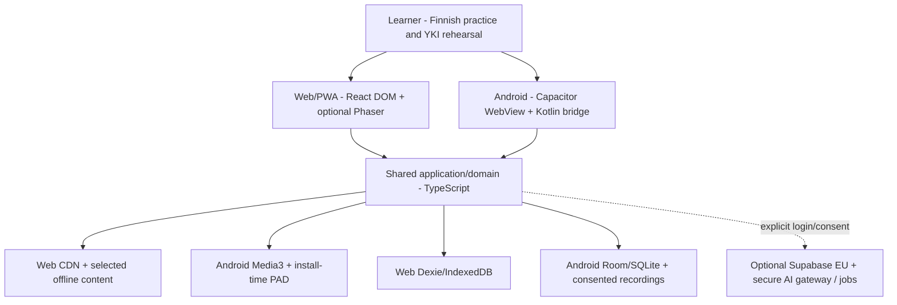
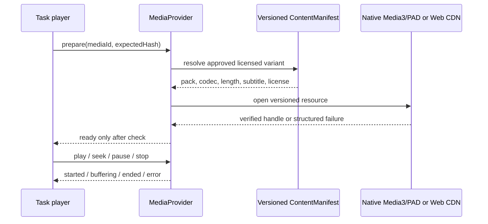

# Hospodar YKI — Reference Architecture & Domain Boundaries v1.0

**Companion:** [Master specification](27-master-product-and-system-spec-v1.md) · [Wire/data contracts](29-cross-platform-protocols-and-data-contracts.md) · [Verification & release](30-quality-gates-release-and-migration.md).  
**Baseline 22.10.2026:** `main b276e7f94fc830db0b835eef99079c4dbfa8622f`. **TARGET** architecture, not an implemented React or Android build.

## 1. Architecture decision

**Offline-first modular monolith with ports/adapters; two equal-priority delivery targets; an optional managed cloud extension.**

We retain: `TypeScript strict` + `React/Vite` UI + lazy-loaded `Phaser 2D` + `XState` for constrained exam and recording workflows; `Capacitor 8 / Kotlin` Android shell; `Dexie/IndexedDB` Web; `Room/SQLite` Android; `Play Asset Delivery install-time + Media3` native media; Web `HTTPS CDN + explicit offline packs`. `pnpm` workspaces; GitHub Actions, Vitest, Playwright and Android instrumentation. `Supabase Auth/Postgres/Storage in verified EU location` and server-side AI/workers are optional P1/P2 features.

**Why:** one logic/scoring/quest codebase, isolation of exam fidelity, replaceable media/storage providers, simple static hosting, small runtime without online dependence. **Do not** add Next SSR/Kubernetes/microservice/message broker/GraphQL by default.

### C4-level context



An actual runtime chooses **one** media and storage adapter based on platform; the diagram shows available implementations, not simultaneous writes to Room and Dexie. The learning domain is shared but **local databases are not dual-written**.

### Dependency rule

```text
Platform UI / Phaser / XState orchestrators → Application use cases → Pure domain
                                                   ↓  ports interfaces
Platform adapters (Dexie, Room, CDN, Media3, AI gateway) ←┘
```

*Domain must not import React, Phaser, Capacitor, Kotlin, Supabase, global browser APIs, API key SDKs, or database queries.* Application layer owns interaction with ports, injected clocks/UUID/storage callbacks and errors. **No network, filesystem, side effects or time sampling in pure domain code.**

## 2. Physical monorepo structure — build only when needed

```text
/ (existing repository retained)
├── apps/
│   ├── web/                         React + Vite + Router; shared WebView-compatible bundle
│   └── android/                     Capacitor Android shell, Kotlin/Room/Media3, PAD Gradle packs
├── packages/
│   ├── contracts/                   runtime + TypeScript schemas, fixtures, version protocol
│   ├── domain/                      tasks, answers, immutable events, skill evidence, SRS
│   ├── learning-engine/             policy for adaptive sessions, repair and transfer
│   ├── exam-engine/                 XState exam state machine + pure validated grading
│   ├── game/                        Phaser scene modules, quest presentation adapter
│   ├── media/                       provider interface and manifest validation
│   └── ui/                          branded, accessible React DOM primitives
├── native/android/                  current prototype -> migrate into real Gradle project
├── content/                         existing authored JSON and controlled source of truth
├── media-manifests/                 publish metadata, rights, versions; no 3GB Git binaries
├── scripts/                         import/build/transcode/quality/legal validators
├── research/, docs/, .github/
├── app/                             EXISTING vanilla JS MVP - preserved until parity
└── pnpm-workspace.yaml              add only at first actual package migration
```

**Boundary granularity:** `packages/contracts` already exists as JS runtime validation and in-memory reference, so evolve it rather than invent an unrelated replacement. Avoid empty packages solely for visual architecture compliance. Keep product/story assets source-controlled only when licensing and size permit, bulk media in versioned artifact storage with integrity verification. Lock plugin/dependency versions and document provenance at actual scaffold date; no untested dynamic `latest`.

## 3. Business domain bounded contexts

| Context | Owns | Can read | Cannot own |
|---|---|---|---|
| `ContentCatalog` | approved tasks, metadata, immutable versions, rights, media refs, provenance | published manifests | user progress, session score |
| `Learning` | study planner, recall events, hints, repairs, transfer, SRS cards, skill evidence | catalog + learner read models | official YKI grade, exam hint policy |
| `Exam` | practice exam profile, sections, rule policy, submit state, holdout exposure, independent outcomes | catalog + verified OPH evidence | game rewards, unrestricted hint access |
| `Game` | navigation, NPC state, narrative completion projection | application read model | SRS score, first attempt integrity, persistence driver |
| `Media` | media identity and platform playback state, rights, captions, codec support | catalog pack manifest | learner proficiency |
| `LearnerData` | atomic event/snapshot storage, export/delete, optional sync outbox | domain commands | grading decisions |
| `SpeechFeedback` | consent, recording lifecycle, provider-neutral transcripts/formative suggestions | allowed temporary user recordings | official speaking grade |
| `Telemetry` | non-sensitive technical events and opt-in aggregate quality | anonymized outcome flags | learner raw audio, answer text or secrets |

### Use-case boundaries

- `StartLearnSession`: parse mode/skills, check pack availability, choose unseen study tasks.
- `CommitFirstAttempt`: validate command → atomic repository commit → emit learner event → return revision → render feedback.
- `RepairAndTransfer`: only after an independent first attempt; mutation is a **new evidence event**.
- `PrepareExam`: freeze `examProfile + itemManifest + assetManifest`, preflight media/mic/storage.
- `CommitExamCheckpoint`: persist draft/session navigation under CAS revision; **does not** count as independent first attempt.
- `SubmitExam`: terminal, idempotent, no answers changed afterward; separate per-skill assessment.
- `RunQuest`: Phaser actions route to the same learning use-cases as non-game UI.
- `ExportData`, `DeleteAccountAndLocalData`: explicit user flows; cloud optional, asynchronous deletion receipt if enabled.

### Contract evolution

`Task.contentHash`, `taskVersion`, `manifestVersion`, `ExamProfile.profileVersion`, `AttemptEvent.schemaVersion`, `mediaId` and `rights` cannot be optional for released scored content. Breaking versions require migrations, compatibility fixtures and rollback; format version independent from content version; `contentHash` canonical algorithm pinned in schema. Do not silently reuse an existing ID for changed media or answer key.

## 4. Runtime separation of presentation and behavior

**React DOM** owns reading text, instructions, WAI-ARIA accessible forms, writing editor, native controls, labels, error states, answer review, exported backups and exam. The **Phaser** canvas exists only when the user enters a game scene, lazy-loaded as a chunk, disposed when leaving. Phaser receives immutable `QuestViewModel` and sends `QuestAction` events through a typed port. **Never** let Phaser hold independent authoritative `attempts`, `cards` or `exam.result`.

**XState** for `ExamSession`, `VoiceCapture`, `NativeMedia` only when nontrivial lifecycle/guards make a machine worthwhile. React local state for simple UI toggles. Persist **domain events and validated snapshots**, not opaque framework-internal state as the sole source of user truth. Android background, battery optimization, activity recreation, back gesture and permission changes are explicit actor inputs.

**State selectors:** choose source-of-truth by concern: `LearnerRepository` persists responses/SRS; `ExamEngine` enforces policy; `ContentCatalog` owns published item versions; `Game` renders a projection; `MediaProvider` owns playback handle/lifecycle. Avoid React/Phaser/store multi-master updates.

## 5. Read/write paths and failure safety

### Reading and answering

```mermaid
sequenceDiagram
  participant UI as React/Phaser
  participant USE as Application
  participant D as Pure domain
  participant DB as LearnerRepository
  UI->>USE: submit response + expectedRevision
  USE->>D: validate + classify event
  D-->>USE: immutable command
  USE->>DB: commitAttempt(command)
  DB-->>USE: ack committed / duplicate / conflict / failure
  alt acknowledged
     USE-->>UI: new revision; proceed or feedback by mode
  else failed
     USE-->>UI: stay on task + retry/export, no false completion
  end
```

**Atomic transaction boundary is the storage provider**, not a callback spanning the WebView-to-Kotlin bridge. Android Kotlin `@Transaction` command handles CAS revision + event insert + snapshot update in one SQLite transaction; Web Dexie does the equivalent in one IndexedDB transaction. Both must return **the same semantic result** and structured error codes.

### Media



**Android:** `install-time` PAD packaged as split APK assets; `AssetManager` accesses them; `openFd` only for uncompressed assets. Configure media file types appropriately and test Media3 seeking with a **real Play-installed AAB**, not just `adb install` of base APK. [Google PAD delivery](https://developer.android.com/guide/playcore/asset-delivery), [asset access](https://developer.android.com/guide/playcore/asset-delivery/integrate-java), [`openFd` constraint](https://developer.android.com/reference/android/content/res/AssetManager). Seekable file descriptor requires correct offsets and lengths; never assume `file://` from WebView. Native player or verified content URI provider with range semantics preferred.

**Web:** HTTPS or same-origin asset URLs; caching only with explicit user action/quota estimates; the Web media provider cannot assert `verifiedHash=true` until actual bytes hashed and verified. Use network request ranges for long videos; CORS and CSP are tested. A browser may evict IndexedDB/CacheStorage/OPFS; show unavailable pack clearly, leave attempts exportable while still present.

### Big install resource constraints

- 2–3 GB target measured as Play delivered compressed size **per device**, not arbitrary source directory sum. One pack and base module caps enforced by official Google Play publication rules; CI + Play Console reports are authoritative.
- `install-time` asset packs require sufficient free space, documented by Google as at least **2× combined pack size** for installation/updates. Alert users to disk constraints without claiming precise free space for their device.
- Hot media decoded only when visible, never load entire pack into RAM. Use lifecycle cleanup and resource ceilings; game FPS is adaptive on midrange Android, not forced 60fps during reading.
- Pack updates must not silently replace content for an active exam; pin `manifest hash`, show an explicit compatibility message and reopen the old referenced version if installed/available. Graceful stop/restart if impossible, keeping prior work.

## 6. Optional cloud and security boundary

```text
Web/Android local first
  ↳ authenticated opt-in sync API → Supabase Auth + Postgres RLS (region selected and verified EU)
  ↳ explicit AI processing consent → secure API gate (rate limit, schema/auth, data minimization)
       ↳ durable queued job → model provider worker → expiring review artifact → user UI
```

- Native app cannot assume permanent connectivity. The outbox retries with exponential backoff and idempotency keys. **Do not sync partial exam states under blind last-write-wins**: conflicting revisions block/resolution flow. For multi-device, choose one active exam owner or explicit conflict UI.
- Never place service-role, LLM or TTS provider secrets in Web/Android code; rotate credentials. Row Level Security on every personal table and storage route; validate ownership, signed media URLs, rate-limits and bounded upload sizes. Storage encryption/secure transport and retention schedule required before consented uploads.
- AI content is untrusted: validate structured output, bound size, filter prompt injection carried by texts or transcripts, keep answer keys invisible to model during unsubmitted exam. No model-generated official grade.
- GDPR: EU DB deployment alone does not prove provider/subprocessor region or lawful processing. Maintain processing register, DPA, data transfer map, user export/deletion. Analytics default to no raw text/audio; no health/sensitive profile auto-detection.
- Refuse unlicensed media redistribution: YouTube URLs/SOLKI historical demos are reference links unless explicit license permits bundling.

### Trust / threat boundaries

| Threat | Mitigation, owner |
|---|---|
| Learner modifies client answer keys | Never claim serious secure high-stakes assessment from offline bundled keys; server grading for genuinely secure assessment |
| Broken plugin/JS message | command schema validation on both JS and Kotlin; strict allowed operations, max size, no arbitrary file path |
| Multi-tab or replayed event | idempotent UUID, immutable event fingerprint, CAS expected revision, duplicate semantics |
| Missing/changed media | hash/license manifest, ready/error state, no fake completion |
| AI prompt injection | model is advisory, constrained output and no privileged tool dispatch |
| Raw voice leakage | explicit consent, app-private storage, short retention, no logging |
| Browser data eviction | export, persist request where available, optional consented sync |
| App update during active exam | pinned manifest, update guard, migration/restore gate |
| Invalid future OPH format assumption | fail-closed official profile; source/date/claim evidence registry |

## 7. Packaging and deployment

**Web:** Vite static build to CDN, CSP and caching headers; hashed chunks, controlled service-worker update activation, preview deployments. No backend required for offline preloaded tasks; streaming online media requests documented. **Android:** reproducible signed AAB from the *same* compatible frontend build, Gradle and Kotlin locked versions, PAD `install-time` modules generated from immutable published manifests, Media3 native player, optional User Data Backup policy after privacy threat model. **No 3GB binary blobs in public git.**

**Monorepo CI:** typecheck/domain/unit/contracts/licensing on PR; browser integration and emulator smoke on changes to platform code; internal Play testing + physical low/mid Android matrix + large-pack synthetic AAB on release gates. Use signed releases only from restricted CI environment. Return to a known-good signed version and content manifests on rollback.

## 8. Migration path from actual code (do not rewrite blindly)

- **Stage 0:** preserve `app/` and tests; add canonical protocol fixtures, one hash algorithm, migration inventory. Ship docs and validations separately.
- **Stage 1:** consolidate `packages/contracts` first-attempt events + `app/attempt-storage` checkpoints at application-service boundary. Keep both record types but one versioned envelope and revision authority; cleanly migrate old IDs and state.
- **Stage 2:** create `apps/web` React/Vite TypeScript shell, import current exercises and route parity; use Dexie adapter, real-browser E2E offline/kill/dual-tab tests.
- **Stage 3:** insert Phaser story `QuestAction` adapter, test scene disposal and accessible non-game completion.
- **Stage 4:** create full Capacitor Gradle Android app with Room/Kotlin `commitAttempt` bridge and real Media3 + PAD; use licensed or synthetic large assets, internal Play test. **Native Kotlin prototype presently not compiled**.
- **Stage 5:** full verified content sets + exam profiles + double-rated calibration + Android 2–3GB media library if rights and benefit justify size; optional cloud/AI later.
- **Stage 6:** release only if [30 release gates](30-quality-gates-release-and-migration.md) pass. Any benchmark/score claim must link real CI/device evidence, not these docs.

## 9. Outstanding decisions that need a test, not opinion

| Decision | Status | Resolution evidence |
|---|---|---|
| Capacitor/Media3 byte-range path for assets in installed split APK | `OPEN_TEST` | AAB on Play internal track, seek/background/video render tests |
| Exact Android Room version, plugin APIs, schema migrations | `OPEN_IMPL` | compiling Gradle project, Kotlin instrumented tests |
| Phaser runtime package version/renderer on target hardware | `OPEN_BENCHMARK` | midrange Android sustained FPS, memory/battery and browser matrix |
| Universal media hash verification versus runtime cost | `OPEN_TRADEOFF` | full hash at publish/pack + sampled/on-demand device verification documented |
| Android process death whilst recording | `OPEN_TEST` | device tests and recoverable temp file lifecycle |
| Official 2027 digital controls/timers | `UNKNOWN_OFFICIAL` | dated authoritative OPH post-pilot source |
| Web persistent browser storage across vendors | `BROWSER_DEPENDENT` | MDN constraints + real-device testing; backup fallback |
| 2–3GB media budget ROI | `UNMEASURED` | actual licensed catalog inventory and quality/retention measures |

**Engineering principle:** implement adapters only after a small independently verifiable vertical slice; add complexity only when measurements, content requirements or accepted security needs justify it.
